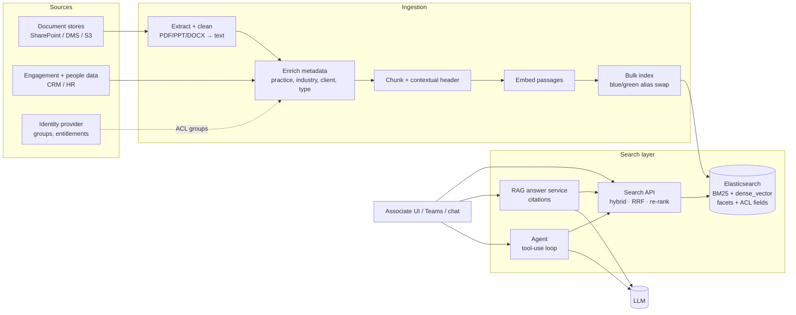
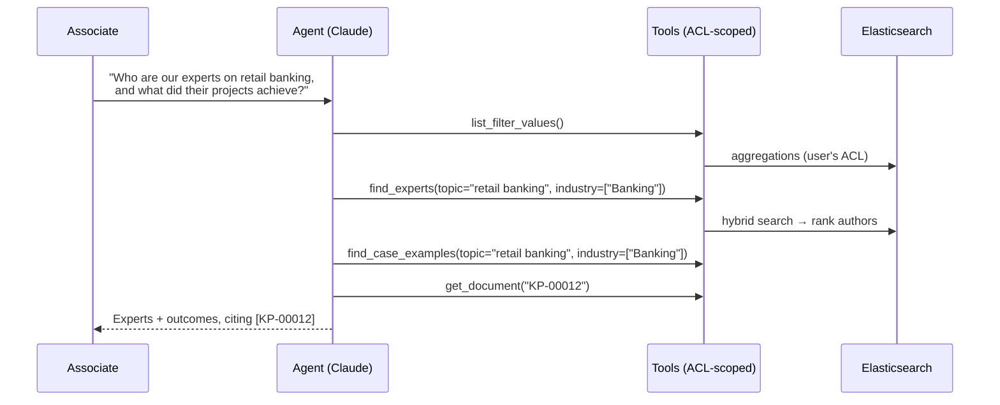

# Architecture

## Big picture

The key idea is that **the AI layers sit on top of the existing search API rather than replacing it**.
RAG and the agent call the same ACL-enforced retrieval the UI uses. Better retrieval therefore improves
every experience at once, and security is enforced in one place.

## Index design

One Elasticsearch document per **chunk** (a passage of about 80 words here; 200 to 500 tokens is typical
for real reports), carrying a copy of the parent document's metadata:

| Field(s) | Type | Why |
|---|---|---|
| `title`, `summary`, `text` | `text` with `kp_index` (index) / `kp_search` (search) analyzers | Stemming at both ends; synonyms only at search time, so they can change without a reindex |
| `title.raw`, `client.lc` | `keyword` with a lowercase normalizer | Exact and known-item matches ("Bluepeak Bank") with a strong boost |
| `facility`, `location`, `service_lines` | `keyword` (+ analysed sub-fields for names) | Client facts: which hospital, where, which services (e.g. cardiology) |
| `practice`, `industry`, `doc_type`, `region`, `authors`, `tags` | `keyword` | Facets, filters and aggregations (doc values; filter cache) |
| `published_date` | `date` | Range filters, freshness boost, year histogram |
| `allowed_groups`, `confidentiality` | `keyword` | Document-level security |
| `embedding` | `dense_vector`, cosine, `int8_hnsw` | Semantic retrieval; int8 quantisation cuts vector memory about 4x |

Why chunk-level documents rather than one document per file?
- Embeddings of whole 40-page reports are blurry. Passages embed well.
- RAG needs passages to cite.
- The trade-off is that results must be grouped back to documents (`group_by_document`), and facet counts
  must count distinct `doc_id`s (a `cardinality` sub-aggregation), not chunks.
- The alternative is a parent document with `nested` passage vectors (supported by kNN since 8.11). It gives
  native one-result-per-document behaviour, but reindexing is heavier when a single passage changes.

## Query flow (hybrid)

1. **Identity → filters.** The user's groups become a `terms` filter on `allowed_groups`. Any facet
   selections and date range are added to the same filter list.
2. **Entities and conversation.** Client and facility names the user can see are recognised (including
   short forms such as "Wrenfield North") and become boosts. In the Ask tab a follow-up such as "Is
   cardiology supported there?" is first rewritten into a standalone question using the conversation.
3. **Query understanding (optional).** "pharma pricing case studies since 2022" becomes the
   filters `industry=Pharmaceuticals`, `doc_type=case_summary` and `date_from=2022-01-01`, plus the query
   "pricing". The LLM agent does this through tool arguments, validated against real facet values.
4. **Two retrievers in parallel**, each fetching about 50 chunks (three for an associate staffed on a
   client; see below):
   - BM25 `multi_match` over title^3, summary^1.5, text, tags^2, client and facility names (boosted), with a phrase bonus and a
     mild recency bonus.
   - kNN on `embedding` with the **same filters as a pre-filter** and a minimum similarity, so nonsense
     queries return nothing instead of the "nearest" junk.
   - For associates staffed on a client, a third "my clients" kNN list restricted to that client's
     documents. It raises their client's work when it is relevant, without hiding firm-wide knowledge.
5. **Reciprocal rank fusion:** `score = Σ 1/(60 + rank)`. It works on ranks only, so BM25 and cosine
   scores never need normalising.
6. **Group chunks into documents.** Keep the best passages per document.
7. **Optional cross-encoder re-rank** of the top 30 documents. When the query names a client or
   hospital, the re-ranker's order is blended (RRF) with the first-stage order, because the
   cross-encoder can't see entity boosts.
8. **Facets** (document counts) come back with the results.

## RAG flow

Retrieve (as above) → number the top passages `[1]..[n]` → ask Claude to answer only from them and
cite each sentence → map citations back to `doc_id`, title and source URI.

Guardrails:
- Retrieval is ACL-filtered before generation, so restricted text never enters the prompt.
- Answer only from sources; say "not found" rather than guess.
- Citations are verifiable links. Pair this with groundedness evaluation (LLM-as-judge plus sampled human review).

## Agent flow

Design choices:
- **Narrow, typed tools** instead of letting the model write raw Elasticsearch DSL. This is safer,
  avoids expensive queries and makes the agent easier to evaluate.
- **Validated filters.** A model-proposed `industry="Banks"` is dropped and reported back, instead of
  silently returning zero results.
- **Bounded loop** (`MAX_STEPS`) and a **full trace** returned to the UI, for transparency and debugging.
- **The manual loop** runs unchanged on the Anthropic API and on Amazon Bedrock.
- **Graceful degradation.** With no LLM, a deterministic planner calls the same tools.

## Key trade-offs

| Decision | Chosen | Alternative | Why |
|---|---|---|---|
| Fusion | Client-side RRF | Native `rrf` retriever; linear score blend | No license dependency, transparent, easy to debug; the native retriever is a drop-in when licensed |
| Synonyms | Search-time `synonym_graph` | Index-time synonyms | Update without a reindex; handles multi-word synonyms correctly |
| Vectors | Self-managed embeddings (fastembed / Bedrock Titan) | ES `semantic_text` + inference endpoint; ELSER sparse vectors | Shows the mechanics; `semantic_text` is simpler to operate, and ELSER is strong for English without fine-tuning |
| Granularity | Chunk documents | Nested passages in a parent document | Simpler incremental updates; grouped in the app |
| Agent tools | Typed search tools | Model writes ES DSL | Safety, cost control, testability |
| Security | Filter on `allowed_groups` | ES native DLS roles | Both are valid; native DLS is stronger when the API can act as the user |
