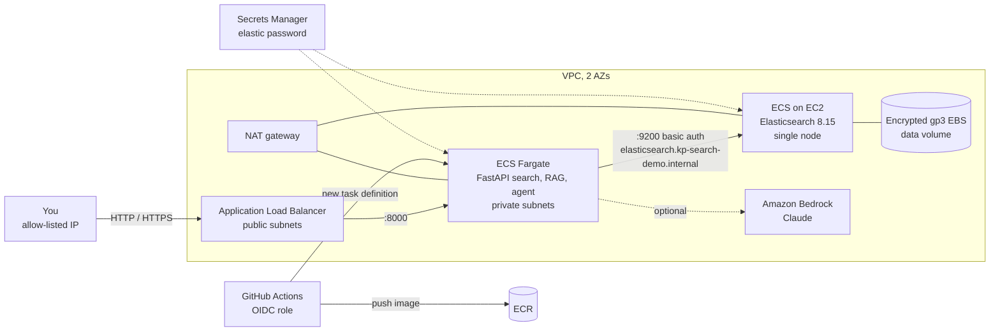
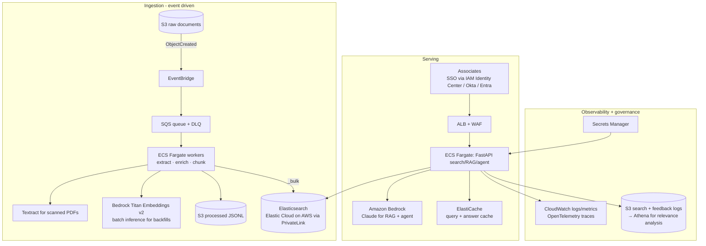

# AWS deployment

This page has two parts:

1. **[Deploy this demo to AWS](#part-1-deploy-this-demo-to-aws).** Terraform and GitHub Actions that run the
   app in your own AWS account.
2. **[Reference design for an enterprise rollout](#part-2-reference-design-for-an-enterprise-rollout).** How
   the same ideas map onto a firm's existing Elasticsearch platform at 117k-document scale.

---

## Part 1: Deploy this demo to AWS

### What gets created



| Piece | Terraform file | Notes |
|---|---|---|
| VPC, subnets, NAT, security groups | `network.tf` | Nothing runs in public subnets except the load balancer. Elasticsearch only accepts traffic from API tasks. |
| ECR, ECS cluster, logs, secrets | `ecr_ecs.tf` | Image scanning on push, 20-image lifecycle, Container Insights, generated `elastic` password in Secrets Manager. |
| Elasticsearch | `elasticsearch.tf`, `templates/es_host_user_data.sh.tftpl` | One EC2 host (Auto Scaling group of 1) with a separate encrypted EBS data volume that is re-attached if the instance is replaced. Security on, private DNS via Cloud Map, shell access through SSM Session Manager (no SSH). |
| API | `api.tf` | Fargate behind an ALB, health check on `/healthz`, deployment circuit breaker with automatic rollback, CPU autoscaling, optional HTTPS. |
| IAM | `iam.tf` | Separate execution, task and host roles. Bedrock permission only when `llm_provider = "bedrock"`. |
| CI/CD | `github_oidc.tf`, `.github/workflows/` | GitHub OIDC role that only `main` of this repository can assume; it can push to one ECR repo and update one ECS service. |

**Rough cost** (us-east-1, running 24/7): about $150 a month, or $5 a day. The main items are the
t3.large Elasticsearch host (about $60), a single Fargate task (about $36), the NAT gateway (about $33
plus data) and the load balancer (about $17). Check the AWS Pricing Calculator for current prices, and
run `make aws-destroy` when you're done.

### Prerequisites

- An AWS account and the AWS CLI signed in with permissions to create these resources, e.g.
  `aws sso login --profile <profile>` then `export AWS_PROFILE=<profile>`.
- Terraform 1.10 or later, Docker, `jq` and `make`.

### Step 1: Terraform state bucket (once)

Pick a globally unique bucket name, create it with versioning, then point Terraform at it:

```bash
aws s3api create-bucket --bucket <your-unique-bucket> --region us-east-1
```

```bash
aws s3api put-bucket-versioning --bucket <your-unique-bucket> --versioning-configuration Status=Enabled
```

```bash
cp infra/terraform/backend.hcl.example infra/terraform/backend.hcl
```

Edit `infra/terraform/backend.hcl` and set `bucket`. For a region other than us-east-1,
`create-bucket` also needs `--create-bucket-configuration LocationConstraint=<region>`.

### Step 2: Settings

```bash
cp infra/terraform/terraform.tfvars.example infra/terraform/terraform.tfvars
```

Set `allowed_ingress_cidrs` to your own IP. Find it with `curl -s https://checkip.amazonaws.com`, then
use `["<that-ip>/32"]`. The demo has no real login (personas are picked in the UI), so don't open it to
the internet. If your account already has a GitHub OIDC provider, set
`create_github_oidc_provider = false`.

`terraform.tfvars` and `backend.hcl` are git-ignored.

### Step 3: Create the infrastructure (about 10 minutes)

```bash
make aws-init
```

```bash
make aws-plan
```

```bash
make aws-apply
```

The API service starts before any image exists, so its tasks fail to pull until Step 4. That's expected.

### Step 4: First deploy and index build

From your laptop (builds a linux/amd64 image, pushes it to ECR, rolls the service and waits until it's
stable):

```bash
make aws-deploy
```

Then build the search index inside AWS as a one-off Fargate task:

```bash
make aws-seed
```

Open the app:

```bash
make aws-url
```

`<url>/health` shows the Elasticsearch version and how many chunks are indexed.

### Step 5: Turn on continuous deployment

Print the values GitHub needs:

```bash
terraform -chdir=infra/terraform output github_repository_variables
```

In GitHub, open **Settings → Secrets and variables → Actions → Variables** and add each key and value
as a *repository variable*. None of them are secrets; there are no AWS keys at all, thanks to OIDC.

From then on:
- **Every pull request** runs `CI`: unit tests, `terraform fmt`/`validate` and a Docker build.
- **Every merge to `main`** runs `Deploy to AWS`: build, push to ECR tagged with the commit SHA, register a
  new task definition and roll the ECS service. A failing image is rolled back by the circuit breaker.
- **Actions → Deploy to AWS → Run workflow** with *Rebuild the Elasticsearch index* ticked also re-runs
  the index build.

Until the variables exist, the deploy job is skipped, so merges never fail because of it.

### Step 6 (optional): Claude on Bedrock

1. In the Bedrock console, enable model access for the Claude model you want, in your region.
2. Set `llm_provider = "bedrock"` (and `llm_model` if needed) in `terraform.tfvars`.
3. Run `make aws-plan`, then `make aws-apply`, then `make aws-deploy` to roll out the new environment.

The task role gets `bedrock:InvokeModel*` on Anthropic models only when this is on. If calls are denied,
check the CloudWatch log group `/ecs/kp-search-demo/api` for the exact action and resource, and widen
the policy in `iam.tf` accordingly.

### Tear down

```bash
make aws-destroy
```

This deletes everything Terraform created, including the ECR images, the Elasticsearch data volume
and the secret. The state bucket is left for you to delete.

### Troubleshooting

| Symptom | Check |
|---|---|
| Browser can't connect | Your IP changed; update `allowed_ingress_cidrs` and apply. |
| 502/503 from the load balancer | `aws ecs describe-services --cluster kp-search-demo --services api`; the API logs are in `/ecs/kp-search-demo/api`. Before the first `make aws-deploy` there is no image. |
| `/health` errors, or the seed task fails | Elasticsearch isn't running. Check the `elasticsearch` service events and `/ecs/kp-search-demo/elasticsearch` logs. |
| Elasticsearch task stays PENDING | The host hasn't joined the cluster or the data disk isn't mounted. Open a shell with **Systems Manager → Session Manager** on the `kp-search-demo-es-host` instance and read `/var/log/cloud-init-output.log`. |
| Search returns nothing | The index hasn't been built: run `make aws-seed`. |

### What I would change for production

- **Elasticsearch:** 3 nodes across AZs (or Elastic Cloud on AWS / ECK on EKS), TLS on HTTP, snapshots
  to S3, ILM, and dedicated monitoring.
- **Identity:** replace the persona dropdown with real sign-in. ALB `authenticate-oidc` against the
  corporate IdP, and pass the group claims through to the document-level security filter.
- **Network:** a NAT gateway per AZ, VPC endpoints for ECR, S3, CloudWatch Logs, Secrets Manager and
  Bedrock, and WAF on the ALB.
- **Delivery:** separate staging and prod accounts or workspaces, manual approval before prod, and
  blue/green deployments with CodeDeploy for zero-risk cutovers.
- **Ingestion:** S3 → EventBridge → SQS → workers instead of the one-off seed task (see Part 2).

---

## Part 2: Reference design for an enterprise rollout

This part is a reference design rather than provisioned infrastructure. It assumes the firm already runs
Elasticsearch on AWS, either **Elastic Cloud on AWS** (a managed Elastic deployment in an AWS region,
reachable over AWS PrivateLink) or **self-managed Elasticsearch on EC2/EKS**. If they were starting
fresh, **Amazon OpenSearch Service** would be the AWS-native alternative. The query layer in this repo maps
almost one-to-one: BM25, `knn` and hybrid search all exist there, with small DSL differences.



### Component choices

| Concern | Choice | Notes |
|---|---|---|
| Search engine | Elastic Cloud on AWS (or self-managed on EC2/EKS) | Keep it as is. Add `dense_vector` fields and new index versions behind aliases. |
| Embeddings | Bedrock Titan Text Embeddings v2 (512 or 1024 dims) or Cohere Embed on Bedrock | Use Bedrock **batch inference** for the 117k-document backfill and synchronous calls for incremental updates. Pin the model version and store it in the index metadata. |
| LLM | Claude on Bedrock (`anthropic.claude-opus-5-5`; a smaller model for query rewriting and routing) | Data stays in the AWS account. IAM-scoped, VPC endpoints, no training on prompts. |
| Re-ranking | Bedrock rerank models, or Elastic's `text_similarity_reranker` with an inference endpoint | Top 20 to 50 results only. |
| API compute | ECS Fargate (steady traffic, long agent calls) | Lambda suits ingestion fan-out but not multi-step agent runs. Long agent runs should stream. |
| Ingestion | S3 → EventBridge → SQS → Fargate workers | Idempotent `_id`s, a DLQ for poison documents, replayable from S3. |
| Identity | SSO (OIDC/SAML) → JWT on every request | Group claims map to `allowed_groups`. ACL changes sync incrementally from the source systems. |
| Secrets | Secrets Manager (ES API keys) | No keys in images or environment files. |
| Network | Private subnets, VPC endpoints for Bedrock/S3, PrivateLink to Elastic Cloud | No public Elasticsearch endpoint. |
| Observability | CloudWatch plus OpenTelemetry. Log every query, its filters, the results shown, clicks and answer feedback. | These logs feed relevance tuning and the judged query set. |
| IaC | Terraform modules: network, ecs-service, ingestion-pipeline, elastic deployment (`ec` provider) | Separate state per environment. Index templates and ILM are versioned in Git. |

### Rollout path for an existing platform

1. **Measure first.** Mine the search logs for top queries, zero-result queries and abandonment. Build a
   judged set of 50 to 100 queries with SMEs.
2. **Quick relevance wins** (no AI): synonyms, field boosts, metadata quality, freshness, title matches,
   and boosting by document type.
3. **Add vectors alongside BM25.** Create a new index version with a `dense_vector` field, backfill the
   embeddings, then serve hybrid search behind a feature flag with an A/B test or interleaving.
4. **RAG answers** for question-like queries, shown above the result list, always with citations.
5. **Agentic workflows** for multi-step tasks: experts, prior case examples, proposal research. Start
   with narrow tools and human-in-the-loop.
6. **Continuous evaluation.** Run offline metrics on every change, plus online CTR, reformulation rate,
   answer thumbs-up and groundedness sampling.
