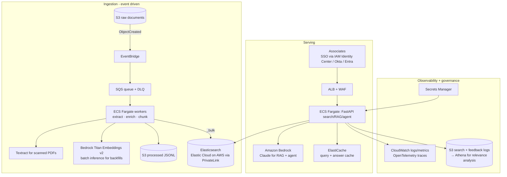

# AWS deployment sketch

This is a reference design rather than provisioned infrastructure. It assumes the firm already runs
Elasticsearch on AWS, either **Elastic Cloud on AWS** (a managed Elastic deployment in an AWS region,
reachable over AWS PrivateLink) or **self-managed Elasticsearch on EC2/EKS**. If they were starting
fresh, **Amazon OpenSearch Service** would be the AWS-native alternative. The query layer in this repo maps
almost one-to-one: BM25, `knn` and hybrid search all exist there, with small DSL differences.

## Component choices

| Concern | Choice | Notes |
|---|---|---|
| Search engine | Elastic Cloud on AWS (or self-managed on EC2/EKS) | Keep it as is. Add `dense_vector` fields and new index versions behind aliases. |
| Embeddings | Bedrock Titan Text Embeddings v2 (512 or 1024 dims) or Cohere Embed on Bedrock | Use Bedrock **batch inference** for the 117k-document backfill and synchronous calls for incremental updates. Pin the model version and store it in the index metadata. |
| LLM | Claude on Bedrock (`anthropic.claude-opus-5-5`; a smaller model for query rewriting and routing) | Data stays in the AWS account. IAM-scoped, VPC endpoints, no training on prompts. |
| Re-ranking | Bedrock rerank models, or Elastic's `text_similarity_reranker` with an inference endpoint | Top 20 to 50 results only. |
| API compute | ECS Fargate (steady traffic, long agent calls) | Lambda suits ingestion fan-out but not multi-step agent runs. Long agent runs should stream. |
| Ingestion | S3 → EventBridge → SQS → Fargate workers | Idempotent `_id`s, a DLQ for poison documents, replayable from S3. |
| Identity | SSO (OIDC/SAML) → JWT on every request | Group claims map to `allowed_groups`. ACL changes sync incrementally from the source systems. |
| Secrets | Secrets Manager (ES API keys) | No keys in images or environment files. |
| Network | Private subnets, VPC endpoints for Bedrock/S3, PrivateLink to Elastic Cloud | No public Elasticsearch endpoint. |
| Observability | CloudWatch plus OpenTelemetry. Log every query, its filters, the results shown, clicks and answer feedback. | These logs feed relevance tuning and the judged query set. |
| IaC | Terraform modules: network, ecs-service, ingestion-pipeline, elastic deployment (`ec` provider) | Separate state per environment. Index templates and ILM are versioned in Git. |

## Rollout path for an existing platform

1. **Measure first.** Mine the search logs for top queries, zero-result queries and abandonment. Build a
   judged set of 50 to 100 queries with SMEs.
2. **Quick relevance wins** (no AI): synonyms, field boosts, metadata quality, freshness, title matches,
   and boosting by document type.
3. **Add vectors alongside BM25.** Create a new index version with a `dense_vector` field, backfill the
   embeddings, then serve hybrid search behind a feature flag with an A/B test or interleaving.
4. **RAG answers** for question-like queries, shown above the result list, always with citations.
5. **Agentic workflows** for multi-step tasks: experts, prior case examples, proposal research. Start
   with narrow tools and human-in-the-loop.
6. **Continuous evaluation.** Run offline metrics on every change, plus online CTR, reformulation rate,
   answer thumbs-up and groundedness sampling.
